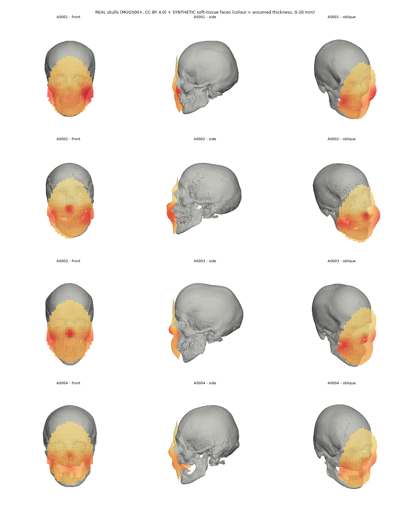

# UNCERTAFACE

**Uncertainty-aware 3D facial reconstruction from incomplete cranial geometry** - an early research prototype.


*Four different real skulls (MUG500+ A0001-A0004) with their synthetic soft-tissue faces (colour = assumed thickness, 0-20 mm).
Skulls: real anonymised CT data, Li et al. 2021, CC BY 4.0. Faces: synthetic.*

> **What is real and what is not.** The skulls in the current dataset are **real, anonymised CT-derived meshes** ([MUG500+](https://doi.org/10.6084/m9.figshare.9616319), CC BY 4.0).
> The **faces are synthetic**: a procedurally generated soft-tissue layer with assumed thicknesses, so a model trained here learns this
> project's face rule, not real craniofacial anatomy. This is **not** a forensic tool, has no forensic or identification validity, and the
> domain gap to real faces is unquantified. See [docs/REAL_SKULLS.md](docs/REAL_SKULLS.md).

## What it does
From a partial, noisy skull point cloud, a PyTorch model predicts a face patch (fixed template topology, ~600 vertices) together with
a per-vertex, per-axis Gaussian predictive distribution in **millimetres**, then calibrates the intervals (split conformal) and evaluates
reconstruction and uncertainty quality.

## Current status (honest)
- **Done and tested (150+ unit/integration tests):** real-skull loading/cleaning/alignment, synthetic face over the skull, observation simulation
  (5 occlusion patterns, 4 severity bins with *measured* missing fraction), leakage-free splits, masked PointNet/PointNet++ encoders, template
  decoder with bounded Gaussian head, losses, trainer (resume, early stopping, health monitors), conformal calibration (global / per-axis /
  per-region / simultaneous), deep-ensemble decomposition, reconstruction + uncertainty metrics, sparsification, stress tests, ablation driver, report generator.
- **Real-skull experiments (60 MUG500+ skulls, synthetic faces):** split 42 train / 6 validation / 6 calibration / 6 test skulls, so every number has
  wide uncertainty. Held-out test vertex RMSE, `face_v3_pn` (PointNet encoder, 150 epochs): **5.86 mm**; `face_v3` (PointNet++): 6.08 mm; mean-face
  baseline 8.11 mm; oracle floor 1.34 mm. Seed-to-seed spread of the same model is about 1.4 mm (`reports/ablation_table.md`), so the 0.2 mm gap
  between the two is not established; the PointNet choice followed validation error and a 60-epoch ablation. Raw 90% intervals cover 95-96%, conformal
  calibration gives 91%. A 3-seed ensemble adds little (epistemic share of variance about 5%). These are errors against *synthetic* faces built
  from assumed anatomy; they say nothing about accuracy on real faces. Not a forensic or identification tool.
  Known failures, reported in `reports/FINDINGS.md`: under 6-10% affine deformation of the input skull the error rises to 9-13 mm while the predicted
  uncertainty barely moves (coverage falls to 60-80%); best-of-N sampling is worse than the single prediction; absolute error is higher than in the
  earlier face-v2 run (not directly comparable). Evaluation settings live in `configs/evaluation.yaml`.
  `scripts/face_from_any_skull.py` takes a broken skull and writes the most likely face, four plausible faces and the face regions ranked by certainty (see `docs/BROKEN_SKULL.md`); `scripts/make_demo_site.py` builds the demo.
- **Earlier results** (`reports/archive_v1_ellipsoid/`) come from a first version whose "skull" was a smooth egg-shaped procedural shell. They are kept
  for the record and are **not comparable** with the real-skull setup. On that toy world the model improved on a no-skull baseline
  (3.19 vs 4.17 mm vertex RMSE; irreducible floor 1.62 mm) with informative but imperfect uncertainty, and intervals needed conformal calibration.

## Layout
| Stage | Where |
|---|---|
| Real-skull fetch (only the .stl meshes, via range requests), cleaning, alignment | `scripts/fetch_mug500.py`, `scripts/prepare_mug500.py`, `src/data/real_skulls.py` |
| Synthetic face over a skull; procedural toy skull generator (used for fast tests) | `src/data/face_from_skull.py`, `src/data/generator.py` |
| Observations, dataset writer, splits, validation | `src/data/pointcloud.py`, `build_dataset.py`, `geometry_sources.py` |
| Normalisation (exact mm conversion), augmentation (incl. joint warp + mirror), `Dataset` | `src/data/preprocessing.py`, `augmentation.py`, `dataset.py` |
| Model, losses, trainer | `src/models/`, `src/losses/`, `src/training/` |
| Calibration, ensembles | `src/uncertainty/` |
| Metrics, stress tests, ablations, floor, report | `src/evaluation/` |
| Visualisation (static + interactive) | `src/visualization/` |
| Docs | `docs/METHODOLOGY.md`, `docs/REAL_SKULLS.md`, `docs/GENERATOR.md`, `docs/PHASE1_FEASIBILITY.md` |

## Quick start
```bash
python -m venv .venv && .venv/Scripts/activate        # Python 3.11/3.12; use the CUDA wheel of torch if you have a GPU
pip install -r requirements.txt
pytest -q                                              # tests use a procedural toy world (no real data needed)

# procedural toy world (fully synthetic, no downloads)
python -m src.data.build_dataset --out UNCERTAFACE_DATA
python -m src.training.trainer --set run.data_root=UNCERTAFACE_DATA run.name=toy

# real skulls + synthetic faces (downloads ~60 MB per skull; data stays in git-ignored folders)
python scripts/fetch_mug500.py --first 60 --variants clear
python scripts/prepare_mug500.py
python -m src.data.build_dataset --config configs/dataset_mug500.yaml --out UNCERTAFACE_DATA_REAL
python -m src.training.trainer --set run.name=real augmentation.warp_mm=3 augmentation.mirror_prob=0.5
python -m src.evaluation.run_evaluation --run experiments/runs/real
```

## Reading results honestly
- `reports/RESULTS.md` is generated from saved JSON (no hand-typed numbers); `reports/FINDINGS.md` is the human interpretation when present.
- Splits: train fits weights; validation selects checkpoints; **calibration** fits conformal calibrators only; **test** is for final reporting only.
- Pointwise (marginal) interval coverage is never presented as simultaneous whole-surface coverage; best-of-N is oracle-selected and reported separately.
- Failed or abandoned runs are kept (see `ABORTED.txt`) and excluded from reported tables.

## Data, citation, licence
- Code: MIT, see `LICENSE` (covers the code only; no statement about suitability for forensic or identification use).
- Skull data (not redistributed here): Li J. et al., *MUG500+ Repository*, Figshare 2021, DOI 10.6084/m9.figshare.9616319 (CC BY 4.0), and
  Li J. et al., *MUG500+: Database of 500 high-resolution healthy human skulls and 29 craniotomy skulls and implants*, Data in Brief 2021, DOI 10.1016/j.dib.2021.107524.
  The gallery image above is a derivative rendering and carries the same attribution.
